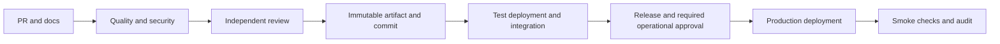

# Deployment Pipeline

The manual workflow runs only from `main`, reuses CI, packages the exact Git commit,
and promotes the same source artifact through test/production. Environment adapters
deliberately fail until implemented. It is a source-bundle scaffold, not a production
container release or Terraform apply.

Python release extends this to build a non-root runtime image once, generate an SBOM,
scan and publish it, then promote its digest. Add signature/provenance verification,
health checks, and registry permissions. Never deploy the development tooling image.

Ignition release packages reviewed project/tag deliverables with checksums; record
compatibility, import order, backup, post-import states, and gateway acceptance. Promote
the same tested files. Terraform adapters bind approval to an exact protected saved
plan and source commit; do not upload potentially sensitive plans as public artifacts.

Document which tool owns each deployment field. Terraform infrastructure changes must
not reset pipeline-promoted images, and release scripts must not silently overwrite
Terraform-managed configuration. Verify the agreed boundary through post-release drift
checks. Database-changing releases follow the database profile's compatibility, parity,
and cutover criteria; a healthy HTTP endpoint alone does not prove migration correctness.

## Required GitHub Settings

1. Protect `main`: PRs, independent approval, dismiss stale reviews, resolved conversations,
   and Quality, Documentation, Infrastructure, Security checks. Require CODEOWNER review
   and restrict bypass, including administrators where possible.
2. Replace commented CODEOWNERS with real teams for workflows/policy, skills, Terraform,
   database migrations, and control-write code.
3. Create protected `test` and `production` environments before deployment. Require
   reviewers, prevent self-review, restrict to `main`, and verify GitHub plan support.
4. Control releases need a separate operational approval environment/job; one reviewer
   list does not guarantee approvals from two independent roles.
5. Grant OIDC only to credential-consuming protected deployment jobs after activation.
   Bind cloud trust to the exact repository/environment. No credentials in PR CI.
6. Serialize releases/applies and scope identities narrowly. Define artifact/audit
   retention; this scaffold's source bundles expire after 14 days.

After all activation requirements are reviewed, set the repository variable
`DEPLOYMENT_ENABLED=true`. This alone does not enable execution: the adapter still
fails until real test/production deployment and smoke checks have been implemented.
Never replace the adapter with `echo` or a successful no-op.

The development-image security gate fails on fixable high/critical vulnerabilities.
An earlier full-report step includes unfixed findings for documented assessment;
the failing step's `--ignore-unfixed` excludes them, not because they are harmless.
Reviewers must resolve or explicitly accept remaining risk with an expiry. Runtime
release images need security gates, SBOM, and provenance checks before promotion.

Adapters refuse unknown targets and verify artifact checksum/digest and authorization.
Approval binds the exact commit/artifact. No arbitrary-command workflow input. Use
ephemeral runners; isolate OT self-hosted runners from untrusted PR code.

## Acceptance And Recovery

Implement real readiness/data-contract checks and gateway/operator acceptance.
Production failures fail the workflow and alert the owner. Recovery is human-approved,
not unrestricted automatic destroy. Test persistence, restoration, licensing, schema
compatibility, and recovery time. Equipment actions may be irreversible.

Record source commit, checksum/digest, versions, evidence, approvers, timestamps,
outcome, and rollback reference without secrets. Docs are reviewed in each PR before
merge; release evidence supplements them rather than deferring updates.